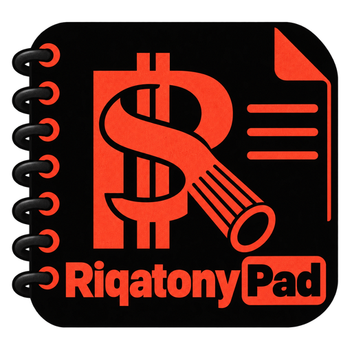

<p align="center">
  <a href="https://github.com/brunonlinespace/riqatonypad">
    
  </a>
</p>

# RiqatonyPad

**Friendly. Fast. Focused.**

RiqatonyPad is a standalone Rich Text Format editor focused on fast, standards-based rich-text editing with a full Ribbon interface, an optional compact Retro command bar, strong file-safety behavior, and ordinary `.rtf` files that remain usable outside the application.

Current release: **2.0.0**

Repository: <https://github.com/brunonlinespace/riqatonypad>

## What RiqatonyPad is

RiqatonyPad is designed for people who want a dedicated desktop RTF editor without a workspace database or private document format. Documents remain ordinary `.rtf` files on disk and can be opened directly from the file manager, command line, drag and drop, or RiqatonyPad itself.

The application combines a touch-friendly Ribbon with an optional Retro command bar, while both interfaces use the same underlying editor actions and document model.

## Highlights

- Standards-based **Rich Text Format editing** with no private document format.
- Full-width **Ribbon** with File, Home, Insert, Configure, and Help pages.
- Optional **Retro** interface using the same command inventory in one configurable horizontal command row.
- Four persistent **Editor Layout** arrangements for toolbar and Find/Replace placement.
- Unified **Find / Replace** panel with live search, gold result highlighting, next/previous navigation, bounded replacement, and match counts.
- Persistent **Locked Mode** for protecting documents from accidental editing while preserving navigation, selection, copying, and search.
- Safe Save, Save As, Duplicate, Rename, Delete, external-editor, and containing-folder workflows.
- External-change detection with guarded save behavior and protection when an open backing file is deleted or renamed away.
- Missing-backed documents remain open and can be preserved with **Save Version As…** or explicitly recreated.
- Configurable drag-and-drop behavior: open RTF files in the active window or in new RiqatonyPad windows.
- System, Dark, and Light application themes with independent **Dark Editor** control.
- New Document Defaults for font, size, style, alignment, and line spacing.
- Print, Page Setup, custom print headers/footers, and PDF export.
- Searchable Keyboard Shortcuts, Quick Tour, bundled RTF documentation, and on-demand document Properties including word count.
- Four selectable command-icon families with light and dark variants.

## Interface

### Ribbon

The Ribbon is RiqatonyPad's default command surface.

- **File** — new/open/save, file management, print, page setup, export, and exit actions.
- **Home** — clipboard, font, formatting, paragraph, alignment, and editing commands.
- **Insert** — links, images, tables, horizontal rules, symbols, dates, and times.
- **Configure** — view controls, editor settings, themes, icon families, and application behavior.
- **Help** — documentation, Quick Tour, shortcuts, GitHub, issues, and About.

Hover over a Ribbon command to see its name and keyboard shortcut. Ribbon command icons are displayed at 36×36 inside RiqatonyPad's established 52×52 command controls.

### Retro

**Retro** presents the same shared RiqatonyPad command inventory in one horizontally scrollable 52×52 row.

Use **View → Editor Toolbar → Retro** or `Ctrl+Alt+Shift+T` to switch between Ribbon and Retro. **Customise Retro Bar…** lets you choose which applicable commands and selectors appear in the Retro row.

Changing between Ribbon and Retro does not change the selected Editor Layout or move the Find/Replace panel independently.

### AppMenu

The native application menu is organised as:

**File · Edit · Format · Insert · View · Settings · Help**

The menu and command surfaces share the same actions. The Keyboard Shortcuts dialog reads the live application actions so current shortcuts remain discoverable.

## Editor layout

RiqatonyPad provides four persistent toolbar/Find arrangements:

1. **Toolbar Top / Find Bottom** — `Ctrl+Alt+Shift+1` — default
2. **Toolbar Top / Find Top** — `Ctrl+Alt+Shift+2`
3. **Toolbar Bottom / Find Top** — `Ctrl+Alt+Shift+3`
4. **Toolbar Bottom / Find Bottom** — `Ctrl+Alt+Shift+4`

The Find/Replace panel follows the selected layout in both Ribbon and Retro modes.

## Editing

RiqatonyPad supports:

- font family and size;
- bold, italic, underline, strikethrough, superscript, and subscript;
- text colour and highlighting;
- paragraph styles and line spacing;
- left, centre, right, and justified alignment;
- bullet lists and indentation;
- links and embedded PNG/JPEG images;
- bounded simple tables and table editing;
- horizontal rules;
- symbols;
- date and time insertion;
- print and PDF export.

Character formatting applies to the selection, or to the current word when there is no selection. New documents use the configured **New Document Defaults** while opening an existing RTF preserves the formatting stored in that file.

The Highlight dialog also provides immediate keyboard choices while it is open: **Y** Yellow, **P** Pink, **G** Green, **R** Red, **B** Blue, **O** Orange, **C** Cyan, **N** Noir, and **Backspace** to clear highlighting.

## File handling and drag and drop

RiqatonyPad opens ordinary `.rtf` files directly and keeps file management local to the document window.

The **More Actions** menu provides Duplicate File, Rename File, Delete File, Open in External Editor, Open Containing Folder, and Properties.

Drag-and-drop behavior can be configured under **Settings → App Drag-and-Drop**:

- **Opens on Active Window** — replace the current document after normal save/discard checks.
- **Opens on New Window** — open each accepted RTF in a separate RiqatonyPad window.


## File safety and external changes

RiqatonyPad treats file safety as part of the normal document lifecycle.

Ordinary saves use guarded replacement semantics. Before replacing an existing file, RiqatonyPad detects whether its disk content changed externally and offers safe resolution paths instead of silently overwriting another program's changes.

Open documents also survive an externally driven delete or rename-away of their backing path. A missing-backed document remains open and protected: Reload is unavailable while no disk copy exists, **Save Version As…** remains available, and recreating the original path requires an explicit action.

Deleting the current file from inside RiqatonyPad likewise keeps the live document open in the missing-backed lifecycle rather than discarding the in-memory document.

Duplicate and external-editor workflows can be configured to ask every time or use a remembered policy when unsaved changes are present.

## Locked Mode

**Locked Mode** (`F12`) is a persistent protection state. It prevents document mutation while preserving navigation, search, selection, and copying.

The window title identifies Locked Mode when it is active.

## Appearance

Choose **System**, **Dark**, or **Light** for the application shell. A fresh installation defaults to Light. The editor canvas can be controlled independently through **Dark Editor**.

Both Ribbon and Retro use the same packaged light/dark command-icon families, 144 icons per variant. Command buttons use the established 52×52 geometry with 36×36 icons:

- **Riqa Icons Harmony**
- **Riqa Icons Humility**
- **Riqa Icons Heritage**
- **Riqa Icons Halcyon**

## Useful keyboard shortcuts

| Shortcut | Action |
| --- | --- |
| `Ctrl+N` | New document |
| `Ctrl+Alt+Shift+N` | New Window |
| `Ctrl+O` | Open… |
| `Ctrl+S` | Save |
| `Ctrl+Shift+S` | Save As… |
| `Ctrl+Shift+D` | Duplicate File… |
| `F2` | Rename File… |
| `Ctrl+Shift+E` | Open in External Editor |
| `Ctrl+Shift+O` | Open Containing Folder |
| `F4` | Properties |
| `Ctrl+P` | Print… |
| `Ctrl+Alt+Shift+P` | Export PDF… |
| `Ctrl+Shift+Q` | Save and Exit |
| `Ctrl+Shift+V` | Paste as Plain Text |
| `Ctrl+F` | Find; press again while Find has focus to close |
| `Ctrl+H` | Find and Replace; press again while Replace has focus to close |
| `F3` / `Shift+F3` | Next / Previous Find result |
| `Esc` | Close Find/Replace panel |
| `Ctrl+1` / `Ctrl+2` / `Ctrl+3` / `Ctrl+4` | Line spacing 1.0 / 1.15 / 1.5 / 2.0 |
| `Ctrl+Alt+Shift+1` … `4` | Select Editor Layout 1 … 4 |
| `Ctrl+Alt+Shift+T` | Toggle Ribbon / Retro |
| `Ctrl+Alt+Shift+E` | Dark Editor |
| `Ctrl+Alt+Shift+S` | Show / Hide Status |
| `F11` | Full Screen |
| `F12` | Locked Mode |
| `F1` | Documentation |
| `Shift+F1` | Quick Tour… |
| `Ctrl+Shift+/` | Keyboard Shortcuts |

The complete live shortcut inventory is available from **Help → Keyboard Shortcuts**.

## Running from source

RiqatonyPad requires Python 3 and PyQt6 within the supported PyQt6 6.x series.

```bash
python3 -m venv .venv
source .venv/bin/activate
python -m pip install -r riqatony_pad/requirements.txt
python main.py
```

Other useful launch forms:

```bash
python main.py --version
python main.py document.rtf
python main.py document1.rtf document2.rtf
```

When multiple file paths are supplied, RiqatonyPad opens the first in the initial window and additional files in separate RiqatonyPad windows.

## Building the AppImage

The Fedora AppImage builder is included in the source tree:

```bash
./riqatony_pad/packaging/fedora/build-appimage.sh
```

Expected outputs include:

```text
riqatony_pad/dist/RiqatonyPad-2.0.0-x86_64.AppImage
riqatony_pad/dist/RiqatonyPad-2.0.0-x86_64.AppImage.sha256
riqatony_pad/dist/RiqatonyPad-2.0.0-x86_64.build-info.txt
riqatony_pad/dist/RiqatonyPad-2.0.0-x86_64.build-python-lock.txt
```

The builder supports native `x86_64` and `aarch64` Fedora hosts. Run it as the normal desktop user; it is deliberately non-privileged and reports missing host prerequisites instead of installing system packages itself.

A completed AppImage can be rechecked with:

```bash
./riqatony_pad/packaging/fedora/test-appimage.sh
```

## Validation

Run the authoritative static/source gate with:

```bash
bash riqatony_pad/qa/static-qa.sh
```

The retained QA covers application identity, source architecture, file-safety contracts, Ribbon/Retro behavior, themes and icon families, RTF fidelity and interoperability, security checks, bundled assets, shortcut/menu parity, and source-manifest integrity. PyQt6 runtime suites are exercised when PyQt6 is available, and the AppImage builder adds final packaged-runtime smoke and parity checks.

## Configuration

RiqatonyPad stores per-user application preferences outside documents. On Linux, the current configuration file is:

```text
~/.config/brunonlinespace/riqatonypad/riqatonypad.json
```

Documents remain ordinary `.rtf` files and are not embedded into configuration. New-document defaults and application preferences do not replace formatting already stored in an opened RTF document.

## Scope

RiqatonyPad is a **standalone RTF editor**. It deliberately focuses on Rich Text Format rather than becoming a workspace manager, database-backed notebook, Markdown editor, or PDF reader.

Its goal is to provide a focused desktop editing experience while keeping documents portable, inspectable, and usable in other standards-compatible RTF applications.

## License

RiqatonyPad is licensed under the **GNU General Public License v3.0 or later**.

See `riqatony_pad/LICENSE` for the complete license text.

## Links

- RiqatonyPad: <https://github.com/brunonlinespace/riqatonypad>
- Issues: <https://github.com/brunonlinespace/riqatonypad/issues>
- GitHub profile: <https://github.com/brunonlinespace/>

Copyright © 2026 Bruno Machado.
